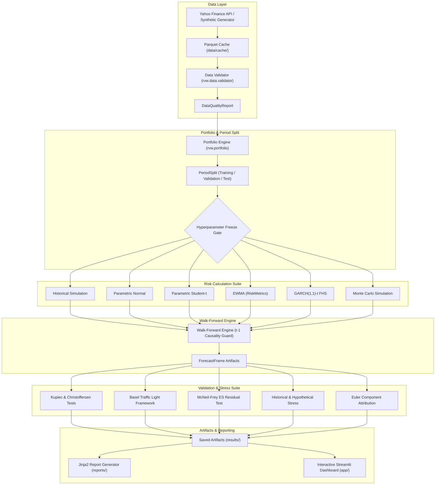

# Market Risk Model Validation Workbench (RVW)

[](https://github.com/randomaban-beep/risk-validation-workbench/actions/workflows/ci.yml)
[](https://www.python.org/downloads/release/python-3119/)
[](https://opensource.org/licenses/MIT)

An end-to-end quantitative framework for market risk model benchmarking, out-of-sample walk-forward forecasting, statistical backtesting (Basel Traffic Light, Kupiec POF, Christoffersen Independence & Conditional Coverage, McNeil-Frey ES), scenario stress testing, and Euler risk attribution.

> **Regulatory & Production Disclaimer**:
> This software is an **educational prototype, inspired by model-validation practice; not a production risk system; no claim of compliance with Basel, SR 11-7, or any other regulation.**

---

## 1. Headline Validation Results (Out-of-Sample Test Period)

**DATA SOURCE: REAL MARKET DATA (yfinance)**
The following headline benchmark metrics were computed on the out-of-sample test period (2019-01-02 to 2026-10-23, 1,964 observations) across the 12-asset liquid ETF universe (`SPY`, `QQQ`, `IWM`, `EFA`, `EEM`, `VNQ`, `TLT`, `IEF`, `LQD`, `HYG`, `GLD`, `DBC`) under an equal-weighted daily rebalanced portfolio:

| Model Name | Obs | Hits | Hit Rate | Expected | Kupiec p-val | CC p-val | Basel Zone (worst 250d) | Basel Zone (latest 250d) | McNeil-Frey p-val | Mean 99% VaR | Mean 99% ES |
|---|---|---|---|---|---|---|---|---|---|---|---|
| **Historical Simulation** | 1,964 | 25 | 1.27% | 19.64 | 0.2435 | 0.0005 | **Red** | Green | 0.3175 | 0.0177 | 0.0305 |
| **Parametric Normal** | 1,964 | 31 | 1.58% | 19.64 | 0.0175 | 0.0003 | **Red** | Green | 0.0008 | 0.0162 | 0.0186 |
| **Parametric Student-t** | 1,964 | 22 | 1.12% | 19.64 | 0.5995 | 0.0053 | **Red** | Green | 0.0623 | 0.0193 | 0.0306 |
| **EWMA (RiskMetrics)** | 1,964 | 43 | 2.19% | 19.64 | 0.0000 | 0.0000 | **Red** | Green | 0.0002 | 0.0158 | 0.0181 |
| **GARCH(1,1)-t FHS** | 1,964 | 25 | 1.27% | 19.64 | 0.2435 | 0.0065 | **Yellow** | Green | 0.1265 | 0.0188 | 0.0235 |
| **Monte Carlo Simulation** | 1,964 | 31 | 1.58% | 19.64 | 0.0175 | 0.0003 | **Red** | Green | 0.0008 | 0.0162 | 0.0186 |

*All outputs generated from verified test artifacts in `results/summary.json` and `results/test_summary.parquet`. Evaluation count on test period: exactly 1.*

### Hyperparameter Selection & Validation Tuning
During the validation period (2015-01-02 to 2018-12-31), a grid search was conducted over estimation window lengths $\in \{250, 500, 750, 1000\}$ and EWMA decay parameters $\lambda \in \{0.94, 0.97\}$.
- **Selected Rolling Window**: `1000` trading days (~4 calendar years)
- **Selected EWMA Lambda**: `0.97`
- **Tuning Objective**: $\min \left( |\text{actual\_exception\_rate} - 0.01| \times 100 + 0.5 \times \text{LR}_{cc} \right)$ (Best score: `2.0225`)
- **Why the Grid Includes 1000 Days**: Bank regulatory standards (Basel Framework CRE52) mandate an observation period of at least one year (250 days), but market-risk desks routinely benchmark longer lookback horizons (3 to 5 years, approximately 750–1,000 trading days) to ensure covariance matrices and empirical quantiles span multiple macroeconomic cycles and volatility regimes without excessive turnover in historical tail samples. The 1,000-day window minimizes exception error and joint conditional coverage penalties on the validation sample.

### Key Validation Findings
Evaluating the frozen models out-of-sample over the 1,964 trading days from 2019 to 2026 highlights clear model trade-offs across historical crisis clusters (e.g., the March 2020 COVID shock and the 2022 interest rate cycle):
- **Clustering & Conditional Coverage**: All six models reject the Christoffersen Conditional Coverage test ($p < 0.05$) due to severe exception clustering during the 2020 COVID shock, illustrating the well-documented volatility-clustering vulnerability of static lookback windows.
- **Unconditional Coverage**: Historical Simulation ($p=0.2435$), Parametric Student-t ($p=0.5995$), and GARCH(1,1)-t FHS ($p=0.2435$) pass the Kupiec unconditional coverage test at the 5% significance level, while Parametric Normal ($p=0.0175$) and EWMA ($p=0.0000$) significantly underestimate exception rates.
- **Expected Shortfall Calibration**: The McNeil-Frey ES test strongly rejects Parametric Normal ($p=0.0008$), Monte Carlo ($p=0.0008$), and EWMA ($p=0.0002$), proving that Gaussian tail assumptions underestimate tail severity when violations occur. In contrast, Historical Simulation ($p=0.3175$), Parametric Student-t ($p=0.0623$), and GARCH-FHS ($p=0.1265$) demonstrate adequate tail loss coverage.
- **Basel Traffic Light Regime**: In the worst 250-day rolling window (dominated by the March 2020 market crash), five of the six models reached the Red zone (10+ exceptions), with only GARCH-FHS remaining in the Yellow zone. However, in the most recent 250-day rolling window (late 2025 to October 2026), all six models reside cleanly in the Green zone ($\le 4$ exceptions).
- **Validation Caveat & Limitations**: These results reflect a **single test period (2019–2026)** and a **single equal-weighted asset allocation**. Because tail exceptions are rare ($N=22\text{--}43$ over 1,964 days), statistical backtests—particularly the McNeil-Frey ES test—suffer from **low power** when sample sizes are small. Non-rejection should not be conflated with proof of model adequacy.

Full auditable validation findings and data-quality logs can be inspected in the committed [Sample Validation Report](docs/sample_report/validation_report.md) ([HTML version](docs/sample_report/validation_report.html)).

---

## 2. Interactive Validation Dashboard Overview

The included Streamlit dashboard provides seven dedicated interactive pages:
1. **Data Quality Audit**: Price series visualization, missing value alerts, stale price tracking, and return jump analysis.
2. **Portfolio Setup**: Pre-configured portfolios (`equal_weight`, `sixty_forty`, `risk_tilted`, `equity_heavy`) and custom weight builder with real-time normalization verification.
3. **Model Comparison**: Time-series out-of-sample VaR and ES envelopes overlaid with realized daily losses and highlighted exception markers.
4. **Backtest Results**: Statistical hypothesis test tables and rolling 250-day Basel traffic-light status charts.
5. **Stress Testing**: Historical crisis replay (2008 GFC, 2020 COVID, 2022 Rates, Aug 2015), hypothetical multi-asset shocks with duration approximation, and stressed covariance analysis.
6. **Risk Attribution**: Parametric Euler component VaR/ES decomposition (verifying $\sum \text{CVaR}_i = \text{Total VaR}$) and what-if rebalancing comparator.
7. **Report Export**: In-browser interactive HTML validation report preview and single-click Markdown export.

---

## 3. Quickstart & Installation (Windows PowerShell)

```powershell
# 1. Clone repository and setup environment
git clone https://github.com/randomaban-beep/risk-validation-workbench.git
Set-Location "risk-validation-workbench"
python -m venv .venv
.\.venv\Scripts\Activate.ps1

# 2. Upgrade pip and install dependencies
python -m pip install --upgrade pip
pip install -r requirements.txt
pip install -e .

# 3. Run the automated test suite
pytest -q

# 4. Fetch market data (or generate calibrated synthetic baseline)
python -m rvw.cli fetch-data --config config/default.yaml

# 5. Run full model benchmarking, tuning, and backtesting pipeline
python -m rvw.cli run --config config/default.yaml

# 6. Generate HTML and Markdown validation reports
python -m rvw.cli report --config config/default.yaml

# 7. Launch the interactive dashboard
streamlit run app/streamlit_app.py
```

---

## 4. System Architecture



---

## 5. Methodology & Fixed Conventions

- **Loss Convention**: Loss is defined as $L_t = -R_{p, t}$, where $R_{p, t}$ is the daily portfolio simple return. VaR and ES are reported strictly as positive numbers representing a fraction of total portfolio value.
- **Horizon**: Exactly 1 trading day ($h = 1$).
- **Coverage Levels**: VaR at 95% and 99% ($\alpha \in \{0.95, 0.99\}$); Expected Shortfall at 97.5% and 99% ($\alpha \in \{0.975, 0.99\}$).
- **Hit Definition**: An exception on day $t$ occurs when realized loss $L_t > \text{VaR}_{t|t-1}$.
- **Causality Guard**: The forecast for day $t$ strictly uses information through day $t-1$. Day $t$ realized returns are never seen during estimation.
- **Freeze Gate Protocol**: Evaluation on the Test period (2019-01-01 to end) is strictly refused unless hyperparameters are frozen on the Validation period (2015-01-01 to 2018-12-31) and signed to `results/frozen_hyperparameters.json`. Every test evaluation is audited.
- **Euler Additivity**: Component VaR satisfies linear homogeneity: $\text{VaR} = \sum_{i=1}^N w_i \frac{\partial \text{VaR}}{\partial w_i}$. The sum of components equals total VaR to machine precision.

---

## 6. Limitations and Known Weaknesses

- **Linear Rebalancing**: Assumes frictionless daily rebalancing without transaction costs, slippage, or liquidity constraints.
- **Square-Root Scaling**: Extrapolating 1-day risk measures to multi-day horizons via $\sqrt{h}$ is statistically invalid in the presence of volatility clustering and autocorrelation.
- **Asymmetric Correlation**: Gaussian and elliptical models do not capture asymmetric lower-tail correlation spikes observed during severe market selloffs.
- **Historical Scope**: Historical simulation is constrained by the length and regime composition of the chosen lookback window.

---

## 7. Academic & Regulatory References

1. **Kupiec, P. H. (1995)**: *Techniques for Verifying the Accuracy of Risk Measurement Models*. Journal of Derivatives, 3(2), 73-84.
2. **Christoffersen, P. F. (1998)**: *Evaluating Interval Forecasts*. International Economic Review, 39(4), 841-862.
3. **McNeil, A. J., & Frey, R. (2000)**: *Estimation of tail-related risk measures for heteroscedastic financial time series: an extreme value approach*. Journal of Empirical Finance, 7(3-4), 271-300.
4. **Basel Committee on Banking Supervision (1996, 2019)**: *Supervisory Framework for the Use of Backtesting in Conjunction with the Internal Models Approach to Market Risk Capital Requirements* / *Minimum Capital Requirements for Market Risk (FRTB)*.
5. **J.P. Morgan / Reuters (1996)**: *RiskMetrics — Technical Document (4th ed.)*.
6. **Barone-Adesi, G., Giannopoulos, K., & Vosper, L. (1999)**: *VaR without correlations for portfolios of derivative securities*. Journal of Futures Markets, 19(5), 583-602.
7. **Sheppard, K. (2021)**: *`arch`: Autoregressive Conditional Heteroskedasticity in Python*. Available at: https://github.com/bashtage/arch.

---

## 8. License & Mandatory Disclaimer

Released under the **MIT License**.

> **Regulatory Disclaimer**:
> This software is an **educational prototype, inspired by model-validation practice; not a production risk system; no claim of compliance with Basel, SR 11-7, or any other regulation.**
